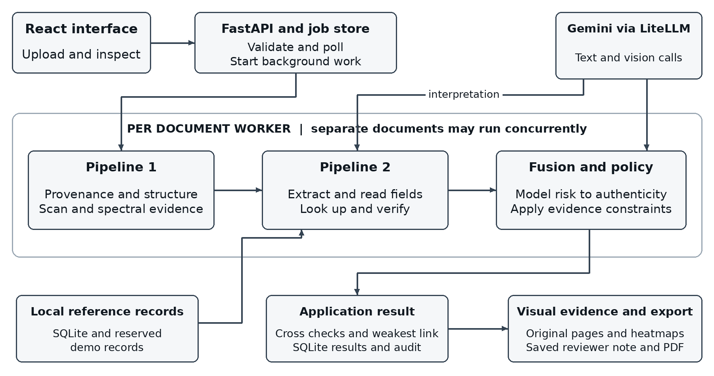
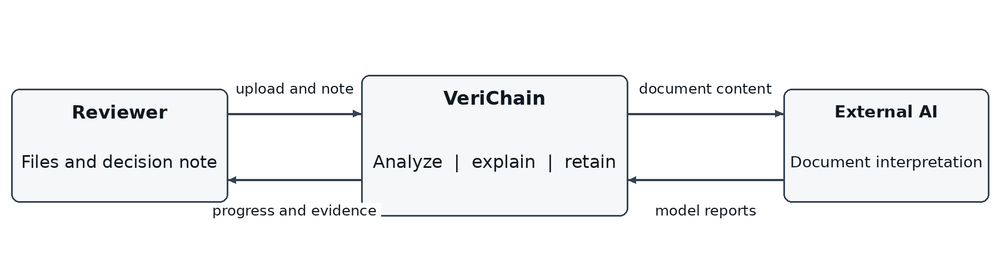
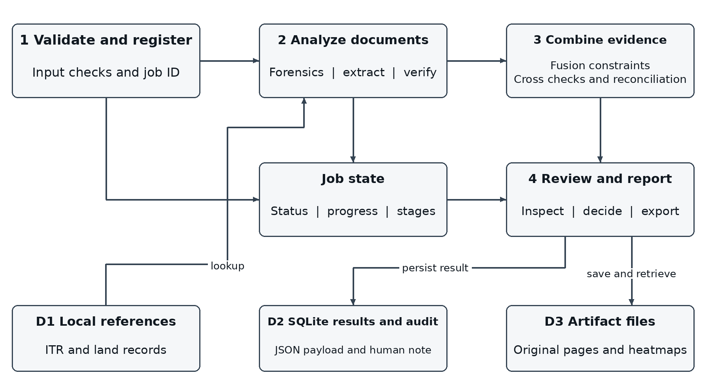
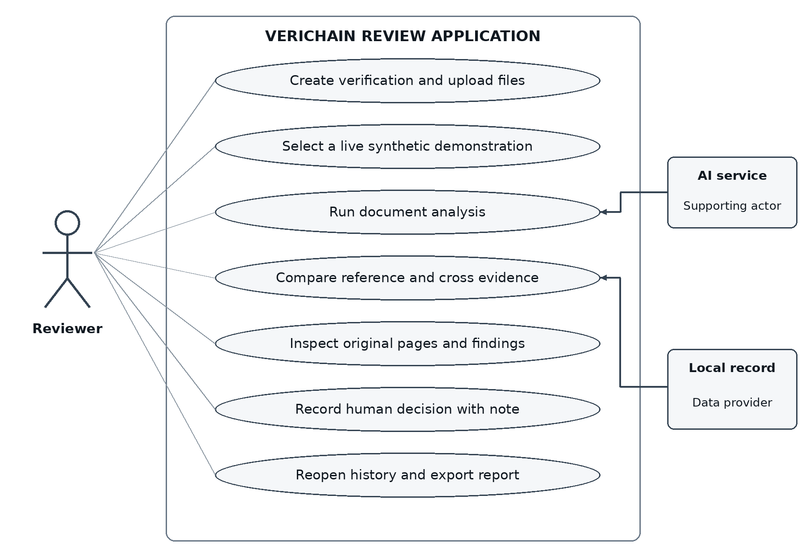
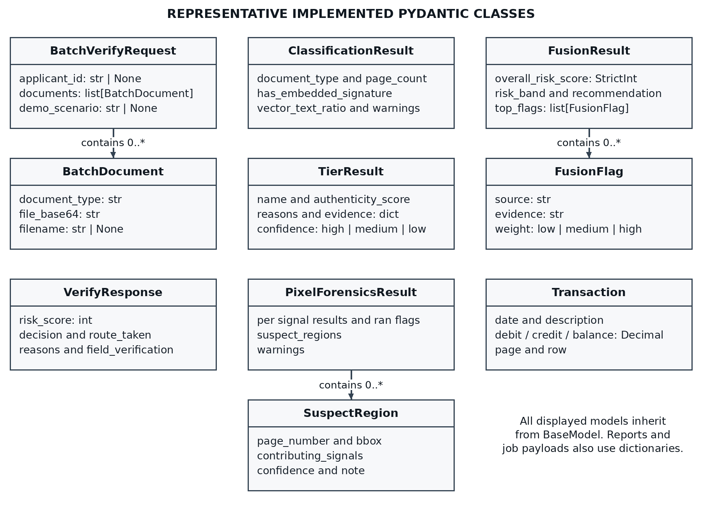
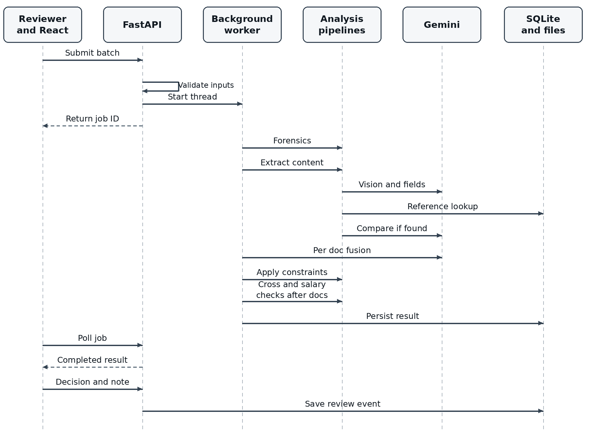
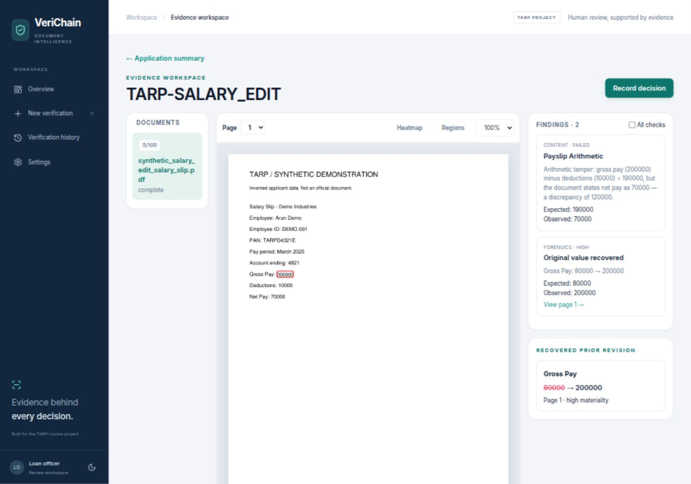

# VeriChain Project Reference

Document fraud detection and evidence based review for loan underwriting

Technical Answers for Real World Problems

Project reference prepared on 19 October 2026

VeriChain examines the authenticity and consistency of land records, income tax returns, salary slips and bank statements submitted with loan applications. It combines file forensics, AI assisted content extraction, reference record comparison and deterministic checks. The result is a score, a system recommendation and inspectable evidence for a human reviewer.

The project demonstrates an integrated college prototype. It does not establish the legal authenticity of every document, replace a bank's lending policy, or independently connect to government and bank portals. Its central result is that complementary checks can expose different kinds of manipulation and present the reasons together.

This reference covers the problem, research context, requirements, feasibility, software stack, architecture, diagrams, implementation, testing, demonstration, measured results and cost considerations. It distinguishes the implemented system from proposed extensions. The documented live evaluation used invented documents on 8 October 2026; those observations are not a fraud detection accuracy benchmark.

Repository baseline a47a11a


# Contents

The numbered chapter and subsection headings below form the reference outline.


# 1 Introduction
## 1.1 Background

A loan application may include documents from several issuers and time periods. An income tax return reports income for a financial period, a salary slip states earnings and deductions for a month, a bank statement records transactions, and a land record describes a holding and its ownership or encumbrances. Reviewers must interpret each document and decide whether the documents describe the same applicant consistently.

Document fraud can involve changing an authentic file or fabricating its contents. Examples include replacing an income figure in a PDF, painting over a balance in a scan, increasing a land holding area, changing an applicant identifier, or creating a convincing salary slip for an employer that has not confirmed it. A visually ordinary file can contain false data, while an unusual looking scan can contain correct data. File appearance and content consistency therefore answer different questions.

Manual review depends on careful reading, domain knowledge and access to trustworthy records. A reviewer may notice an inconsistent font but still need to establish which field changed. Conversely, a perfectly typeset document may require a comparison with another document or a reference record to expose its false claim. VeriChain organizes these checks into a single evidence oriented workflow.

## 1.2 Motivations

The project is motivated by the need to reduce repetitive checking while preserving the reviewer's ability to explain a decision. An unsupported label such as suspicious is less useful than a finding that identifies a source page, an altered amount, an expected value and the rule that failed.

A second motivation is the practical availability of inexpensive tools. PDF parsers, numerical libraries, local storage and a configurable multimodal model make it possible to investigate a useful prototype on a student laptop. Local rules can check arithmetic and identifier structure without an AI call, while the model handles document reading and semantic comparisons that are difficult to express as exact string rules.

A third motivation is responsible handling of uncertainty. Missing issuer records, incomplete OCR and model outages should not be described as proof of fraud. Equally, a reassuring model response must not erase a definitive arithmetic failure or a recovered material edit. The implementation therefore separates evidence generation from final routing constraints.

## 1.3 Scope of the Project

The primary demonstrated scope is Maharashtra style 7/12 land records, Indian salaried income tax returns, salary slips and INR bank statements. Input formats are PDF, JPG and PNG. Files are limited to 25 MB; PDFs must contain one to eight pages and must be readable without a password.

The scope includes batch submission, processing stages, file classification, provenance and structural checks, scan forensics, two pass extraction, local reference matching, deterministic validators, cross document checks, financial reconciliation, constrained scoring, source previews, saved decisions, history and PDF export. Six synthetic packs support live course demonstrations.

The scope excludes a complete creditworthiness assessment, loan pricing, repayment prediction, production identity management, live government verification and a deployed blockchain. Additional schemas in the registry do not mean those document types have the same demonstrated coverage as the four primary types. [P1-P3]


# 2 Project Description and Goals

VeriChain is a browser based review application backed by a Python API. For each uploaded document, it produces two complementary reports: one about the file's forensic characteristics and another about its content and consistency. An AI fusion stage proposes a risk assessment; deterministic policy constraints then determine the permitted authenticity score and recommendation. Application level checks combine the document results without hiding the weakest result.

## 2.1 Literature Review

Document image tampering research studies whether text or regions have been manipulated even when the edit is visually consistent. Qu et al. introduced DocTamper and a document tampering detector that combines frequency information and multiscale features. Their work demonstrates the importance of document specific datasets and compression robustness. VeriChain does not train or integrate that detector; the work informs the need for localized evidence and an eventual labeled evaluation. [R1]

Guillaro et al. proposed TruFor, which combines visual information and a learned noise sensitive fingerprint for image forgery detection and localization. It also estimates where localization may be unreliable. This supports the distinction between a suspicious region and confidence in that region. VeriChain uses simpler classical image signals and does not implement TruFor or its learned confidence maps. [R2]

PDF signature validation provides a different kind of evidence. pyHanko documentation distinguishes cryptographic integrity, certificate trust and changes made through incremental PDF updates. A signature field alone cannot establish that the signer is trusted or that all later changes are acceptable. VeriChain includes an optional offline validation path, but the recorded demonstration did not validate real signatures because the optional dependencies were absent. [R3]

Multimodal document models can read text, tables and visual context. Google's document understanding documentation describes these capabilities. VeriChain uses a configurable Gemini model through LiteLLM, with PDF pages rasterized locally before its vision pass. The current application limit remains eight PDF pages regardless of a provider's larger advertised document capacity. [R4, R10]

| Approach | Useful contribution | Limitation for this project |
|---|---|---|
| Visual or pixel forensics | Can localize traces of image editing | Repeated text, compression and scan artifacts can create false alarms |
| PDF structure and revisions | Can identify structural changes and recover retained prior values | A full rewrite may remove recoverable history |
| Signature validation | Can test signed bytes and certificate trust | Only applies when a suitable signature and trust setup exist |
| OCR and semantic comparison | Can interpret names, formats and document context | Extraction errors and unsupported conclusions require checks |
| Deterministic reconciliation | Produces repeatable arithmetic and identifier findings | Correct arithmetic does not prove issuer authenticity |

These approaches are complementary. The project's contribution is their integration into a small, inspectable underwriting workflow, rather than a claim to a new state of the art detection model.


## 2.2 Research Gap

The engineering gap addressed here is the distance between detecting a suspicious file and helping a reviewer understand an applicant's complete document pack. A useful workflow needs to connect file level clues to financial and identity evidence, preserve the location of findings, distinguish missing verification from an actual contradiction, and retain a human decision with its justification.

The literature cited in Section 2.1 motivates these requirements but does not establish that every existing commercial system lacks them. VeriChain's gap statement is specific to the prototype and its educational problem: combining several evidence sources in a transparent, affordable implementation that can be demonstrated and tested locally.

## 2.3 Objectives

1. Accept the four main loan document categories through a common upload workflow and provide actual job progress.
2. Identify file provenance, PDF structural anomalies, recoverable revision changes and advisory image anomalies.
3. Extract complete document text before deriving structured fields, preserving context such as co owners and transaction rows.
4. Compare the correct applicant or parcel against available local reference records without unsafe fallback matches.
5. Validate identifiers and financial arithmetic deterministically, including documents without a reference record.
6. Compare identities and salary related evidence across documents while treating annualized income as an estimate.
7. Produce a consistent authenticity score and an evidence backed recommendation with explicit incomplete analysis states.
8. Let the reviewer inspect original pages, record a decision with a note, reopen saved results and export a report.
9. Demonstrate the workflow using clearly invented documents and real model calls, with outcomes reported honestly.

## 2.4 Problem Statement

Banks process land records, income tax returns, salary slips and bank statements for loan applications. Forged and altered documents, including edited scans, changed income figures, fabricated salary slips and inflated land areas, can be difficult to identify during manual review. Underwriters need a way to flag suspicious evidence quickly, compare related documents and justify the resulting review decision.

VeriChain addresses this problem by producing decision support rather than an autonomous lending decision. It asks whether the file appears altered, whether the stated data agrees with available evidence, and whether the applicant's documents are consistent with one another. The human reviewer retains responsibility for the final call.

## 2.5 Project Plan

The implemented plan followed an audit driven sequence. High priority work first prevented definitive evidence from being overridden by the model. The next phase corrected extraction coverage, land lookup, page localization, failure recovery and evidence persistence. Financial reconciliation was added before the review interface was redesigned around the resulting structured evidence.

| Phase | Main deliverable | Verification gate |
|---|---|---|
| Audit and requirements | Reproduced caveats and prioritized scope | Local probes and synthetic live evidence |
| Decision policy | Validated fusion score and external routing constraints | Failure injection and threshold tests |
| Evidence correctness | Safe lookup, explicit file limits, page mapping and previews | Input and multipage regression tests |
| Financial checks | Statement arithmetic and salary credit comparison | Positive, negative and ambiguous cases |
| Review experience | Responsive workspace, notes and persistent history | Build and browser workflow checks |
| Demonstration and reporting | Six live synthetic packs and expanded PDF reports | Expected versus observed outcomes |

This sequence is a completed implementation roadmap, not a claim about an institutional semester calendar. Future work should prioritize evaluation and issuer access before adding more document categories. [P1-P3]

The plan prioritizes consequences rather than visual novelty. A false clean result after a provider outage is more consequential than an unattractive screen, so external score constraints and retained forensic evidence were implemented before the redesign. Unsafe parcel selection and lost extraction coverage were addressed before introducing new financial comparisons.

Each phase has an observable completion condition. A policy fix is demonstrated by a controlled contradictory input; a source page fix is demonstrated by an edit confined to page 2; and financial reconciliation is demonstrated by correct, inconsistent and ambiguous cases. The final presentation uses real model calls to distinguish an integrated workflow from isolated unit behavior.

The remaining risks are evaluated rather than hidden. Model quota is managed through shared concurrency and bounded retries. Missing issuer data remains explicit. Optional signature dependencies do not prevent the rest of the demonstration, but the report must not claim cryptographic assurance when that path was unavailable.


# 3 Technical Specification
## 3.1 Requirements
## 3.1.1 Functional Requirements

| ID | Requirement | Implemented behavior |
|---|---|---|
| FR01 | Upload applicant documents | Accept multiple PDF, JPG or PNG files with optional application ID and selected or detected type |
| FR02 | Validate inputs | Reject malformed base64, unsupported or unreadable files, oversized inputs and PDFs outside the page limit |
| FR03 | Track work asynchronously | Return a job ID, expose processing status and stages, and allow polling |
| FR04 | Classify the file | Distinguish signed PDF, born digital PDF and scanned image for forensic routing |
| FR05 | Analyze provenance | Inspect signature structures and QR payloads; expose validation uncertainty |
| FR06 | Analyze PDF structure | Examine dates, producer, fonts, incremental changes and recoverable prior values |
| FR07 | Analyze image evidence | Run scan pixel signals and spectral corroboration as advisory evidence |
| FR08 | Extract document contents | Produce full text and type, then derive schema fields and source related data |
| FR09 | Fetch a reference record | Use PAN and assessment year for ITR, or parcel/locality and full survey identity for land |
| FR10 | Verify extracted fields | Compare semantically with available records and retain individual field outcomes |
| FR11 | Run deterministic checks | Check applicable identifiers, payslip arithmetic and bank balances even without a reference record |
| FR12 | Compare the document pack | Detect identity conflicts and other semantic inconsistencies across at least two reports |
| FR13 | Reconcile salary payments | Compare payslip net pay with a uniquely identified salary credit in a covered statement window |
| FR14 | Produce a recommendation | Apply a shared authenticity scale and evidence constraints after AI fusion |
| FR15 | Inspect source evidence | Display saved original pages, page specific regions, recovered changes, fields and transaction rows |
| FR16 | Save a human decision | Require a nonempty note and persist approved, review or rejected independently of the recommendation |
| FR17 | Reopen and export results | List history, reopen saved results, soft delete history entries and download an evidence PDF |
| FR18 | Demonstrate the system | Load six invented packs into the normal upload flow and run real analysis |


## 3.1.2 Non Functional Requirements

A passed local check does not certify issuer authenticity. Field states distinguish verified, mismatch, missing and unverified. The asynchronous batch API is the main frontend workflow.

Explainability requires findings to retain a source, check code, severity, reason and stable evidence identifier. Where available, the record includes a page, a region, expected and observed values, or a transaction ID. The review interface and exported report should preserve the same meaning.

Reliability requires incomplete analysis to remain visible. A provider outage must not erase previously generated forensic evidence or deterministic cross checks. Invalid model scores must not escape the validated range, and hard evidence must remain effective after a fallback.

Responsiveness is achieved through background jobs and polling rather than an immediate final response. Documents may run concurrently, but model concurrency defaults to one to respect a small API allowance. The system has no measured service level guarantee; the recorded synthetic timings are observations, not target latency promises.

Usability requires readable documents, consistent score direction, responsive layouts, keyboard reachable controls and recoverable errors. The implemented interface supports light and dark reading themes and avoids fabricated confidence percentages. Privacy requires credentials to remain server side and demonstration material to be invented. The prototype has no completed production authentication, authorization, encryption or retention control framework.

Maintainability relies on modules with distinct responsibilities, schema guided extraction, a centralized model client and policy, and regression tests. Completed results persist, while in flight jobs remain process local. This tradeoff is acceptable for the course demonstration but is unsuitable for durable distributed processing.

## 3.2 Feasibility Study
## 3.2.1 Technical Feasibility

The main components are available as Python and JavaScript libraries and have been integrated in the repository. Heavy model inference is remote, so the demonstration does not require a local GPU. PDF rendering, image processing, deterministic checks and SQLite storage run locally. The successful synthetic scenarios establish integration feasibility for small documents; they do not establish real world detection accuracy.

The important technical constraints are internet availability, model quota, OCR quality, missing issuer data, image processing memory, and optional signature support. An eight page input limit, temporary file cleanup, default model concurrency of one and bounded transient retries keep the student deployment manageable.

## 3.2.2 Economic Feasibility

The architecture can use an existing student laptop, local storage and an eligible API allowance. It does not require a paid database server or deployed blockchain. Incremental spending may therefore be small, but it is not inherently zero: API usage, connectivity, storage and development effort still have costs. Section 7 gives a cost model without inventing billing measurements or guaranteed free quotas.

## 3.2.3 Social Feasibility

Evidence based review can help a person explain why a document needs further attention. However, names, regional scripts and noisy scans can lead to unequal extraction quality. A mismatch may reflect OCR error, transliteration or an incomplete reference rather than fraud. Human review, clear uncertainty and inspectable source pages are necessary safeguards.

The system should be presented as an aid to document scrutiny. A low score does not establish criminal intent, and an approve recommendation does not authorize a loan. Testing with invented applicant data avoids exposing genuine personal financial records during the classroom demonstration.


## 3.3 System Specification
## 3.3.1 Hardware Specification

The following are planning estimates for a small local demonstration, not hardware requirements established by a benchmark. Actual memory demand depends on page count, raster resolution, image size and the number of concurrent jobs.

| Resource | Practical starting point | Preferred for a smoother demo |
|---|---|---|
| Processor | Recent 64 bit multicore laptop CPU | Four or more CPU cores |
| Memory | 8 GB RAM | 16 GB RAM for browser and image processing |
| Storage | About 5 GB free for tools and a small demo set | 10 GB or more with regular artifact cleanup |
| Graphics | Integrated graphics | No dedicated GPU required for remote model calls |
| Network | Internet connection for Gemini | Stable broadband with reliable upload capacity |
| Display | Modern browser at laptop resolution | External monitor helpful for side by side evidence review |

Page previews and exported reports accumulate on disk. The 25 MB upload limit is not a total storage quota. An operator should use a separate demonstration database and remove obsolete generated artifacts when they are no longer needed.

## 3.3.2 Software Specification

| Layer | Technology in the repository | Responsibility |
|---|---|---|
| Backend language | Python with modern type hints | API and analysis orchestration; validated on Python 3.12.3 |
| API framework | FastAPI and Uvicorn | HTTP routes, request models, background integration and serving |
| Data validation | Pydantic 2 | API and forensic models, fusion output and bank transactions |
| Model adapter | LiteLLM | Configurable text and vision calls with shared limits |
| Demonstrated model | Gemini 3.1 Flash Lite identifier | Live extraction, semantic comparison and fusion in the recorded run |
| PDF processing | PyMuPDF and pikepdf | Rasterization, text/spans, embedded images and low level PDF objects |
| Image processing | OpenCV and Pillow | Image conversion, feature matching, recompression and QR fallback |
| Numerical processing | NumPy and SciPy | Arrays, robust statistics, DCT/FFT and component clustering |
| Local data | SQLite and Python sqlite3 | Reference records, saved results and audit events |
| User interface | React 18 and TypeScript | Component based review application and typed client models |
| Navigation and build | React Router 6 and Vite 5 | Page routing and frontend development/production builds |
| Styling and icons | Tailwind CSS 3, custom CSS and Lucide React | Responsive layout, themes and review controls |
| Test tools | pytest, FastAPI TestClient and Node test runner | Regression, API and adapter checks |

The version families above describe repository declarations, not a promise that the newest upstream version is installed. Python 3.11 was an intended baseline but was not separately validated in the recorded test environment. Pydantic is not used for every dictionary in Pipeline 2. [R5-R12, P3]


## 3.3.2 Software Specification continued

PyMuPDF, imported as fitz, renders pages, extracts text and words, reads font spans and finds embedded images. pikepdf provides low level access to PDF object dictionaries, document information, encryption and signature fields. These roles overlap in file access but serve different analysis needs. [R5, R6]

OpenCV supplies JPEG recompression for ELA, grayscale and Laplacian operations, ORB descriptors and matching, adaptive thresholding, connected components, geometric measurements and the QRCodeDetector fallback. NumPy supplies array operations and robust statistics. SciPy supplies frequency transforms and connected component routines. Pillow supports image loading and conversion. [R7, R8]

The optional pyHanko and pyhanko-certvalidator path attempts offline cryptographic signature validation. pyzbar can improve QR decoding when installed with the zbar system library; otherwise OpenCV is used. Optional absence must be described as unavailable validation rather than an automatically valid signature or QR identity. The recorded audit found pyHanko absent. [R3, P1]

The frontend package declares React 18.3, React Router 6.28, TypeScript 5.6, Vite 5.4, Tailwind 3.4 and Lucide icons. These are dependency ranges. The backend requirement file also uses minimum versions, so reproducing exact versions requires recording the installed environment in addition to these declarations.

| Configuration | Meaning and default behavior |
|---|---|
| LLM_MODEL | Required provider/model identifier; model choice is not hard coded |
| GEMINI_API_KEY | Credential for a Gemini configured deployment; keep server side |
| LLM_CONCURRENCY | Default 1 active model call in the process |
| LLM_RETRIES | Default 2 transient retries; bounded to at most 2 |
| LLM_TIMEOUT | Model call timeout, default 120 seconds |
| LLM_MAX_TOKENS | Model response token budget, default 16384 |
| LLM_TEMPERATURE | Configurable sampling value, default 0.0 |
| VERICHAIN_DB | SQLite path; defaults to the repository database |
| VITE_API_BASE_URL | Frontend API address; defaults to http://localhost:8000 |

Environment values take precedence over the backend .env file. A health response reports whether model configuration is present; it does not prove a successful live model connection. Document analysis is the actual integration check.

The demonstrated model calls used a Gemini API key through LiteLLM. The implementation does not require Vertex AI and does not justify describing the measured run as Gemini 3.1 Pro on Vertex AI. The provider can be changed through configuration, subject to compatible vision and structured output behavior.


# 4 Design Approach and Details
## 4.1 System Architecture


Figure 4.1 Implemented component architecture

The frontend encodes selected files and submits a batch to FastAPI. The API validates the files before registering an in memory job and starting a background thread. A document worker calls the forensics pipeline, the extraction/reference/verification pipeline and then the fusion stage. These are independent evidence sources in purpose, but they execute sequentially for each document in process_document. Separate document workers can execute concurrently.

Pipeline 1 analyzes the file itself. Pipeline 2 interprets document content and compares it with available local records. Both reports feed per document AI fusion. The policy layer constrains the inverted authenticity score, keeping definitive evidence effective even if the model is optimistic or unavailable.

After document processing, deterministic salary reconciliation and cross document analysis operate on the available verification reports. Semantic cross analysis is attempted when at least two reports are available. The batch result uses the weakest document authenticity and applicable cross evidence; the normal batch path does not run a second global fusion call over the whole application.

Completed jobs are stored as SQLite summary columns and JSON payloads. Original page previews and heatmaps are local files served by the artifacts route. Gemini receives document content through the model client; credentials remain on the backend. The database and artifact store are local components, not external issuer systems. [P3]


## 4.2 Design

The design separates transport, analysis, policy, persistence and presentation. This makes it possible to inspect a failure at the stage that produced it. A missing issuer record is handled in content verification; a model outage is a coverage warning; a hard arithmetic contradiction is enforced by the decision policy; and a reviewer note is stored independently of the system recommendation.

### Data design

| Record | Important fields | Storage and role |
|---|---|---|
| Job | job_id, applicant_id, status, progress, document_stages | Locked in memory dictionary during process lifetime |
| Verification | job_id, timestamps, score, decision, result_json, note, deleted | SQLite verifications table for history and completed result recovery |
| Document result | doc_id, type, findings, fields, coverage, pages, score | Nested in the saved job JSON |
| Evidence finding | id, source, check_code, state/severity, expected, observed, page/region | Nested structured evidence used by the UI and report |
| Bank transaction | transaction_id, date, debit, credit, balance, page, row | Pydantic normalized record inside extracted fields |
| Reconciliation | involved document IDs, expected net, observed credit, difference, source | Nested application financial comparison |
| Audit event | applicant_id, doc_hash, score/decision, timestamp, tx_hash, event_type, note | Local blockchain_log table; mock transaction hash |
| Reference | ITR key or parcel/locality identity and recorded values | Local SQLite records or explicit synthetic demo reference module |
| Page asset | page_number and URL | PNG file in backend/artifacts with URL in job JSON |

The current job store returns a shallow copy under a lock. It is sufficient for this single process demonstration, not a replacement for a distributed queue. Saved JSON accommodates additive evidence without requiring a separate SQL table for each finding. SQLite suits this local educational deployment. [R14] Monetary bank values are serialized as strings to preserve Decimal values through JSON and JavaScript.

### API design

| Method and route | Purpose |
|---|---|
| POST /verify | Synchronous single document compatibility contract |
| POST /verify/batch | Validate inputs and start a batch; return job_id |
| GET /verify/batch/{job_id} | Poll stages or retrieve a completed saved result |
| POST /verify/batch/{job_id}/decision | Save a valid human decision with a required note |
| GET /verify/batch/{job_id}/report.pdf | Generate and download the evidence report |
| GET /verifications | Retrieve saved history summaries |
| DELETE /verifications/{job_id} | Soft delete an entry from visible saved history |
| GET /demo/scenarios and /demo/scenarios/{id} | List or generate the synthetic demonstration packs |
| GET /health and /artifacts/... | Configuration health and saved visual assets |

The legacy field risk_score is an authenticity score at the public API boundary: higher is more trustworthy. This naming is retained for compatibility and must not be confused with the fusion model's opposite risk scale.

A batch request contains an optional applicant_id and a documents array. Each document has document_type, filename and file_base64; the original file bytes are base64 encoded by the browser. The request is JSON rather than multipart form data. A successful submission returns only a job identifier, not a completed verdict.

```text
Illustrative submission fields
{
  "applicant_id": "TARP-DEMO",
  "documents": [{
    "document_type": "salary_slip",
    "filename": "synthetic_salary.pdf",
    "file_base64": "<base64 encoded PDF bytes>"
  }]
}

Initial response
{"job_id": "job_example"}
```

Polling returns status and progress plus document_stages; completed payloads add overall, documents, cross_document, reconciliation, analysis_status and analysis_warnings. Invalid input and an empty decision note receive validation errors, while an unknown job receives a not found response. A processing job is not a complete report.

The UI resolves relative artifact URLs against the API base address. The raw overall score is preserved, arrays such as transactions remain structured, and absent legacy evidence is shown as unavailable. This adapter prevents field names and display formatting from becoming accidental independent sources of risk logic.


## 4.2.1 Data Flow Diagram


Figure 4.2 Context diagram showing system inputs and outputs

The reviewer supplies files, an optional applicant identifier and later a human decision note. The application returns progress, evidence, recommendations and a report. The external model consumes document content for interpretation; its output is evidence for a constrained workflow, not an unrestricted final authority.


Figure 4.3 Level one data flow diagram

Process 1 validates the upload and creates a job. Process 2 generates document reports through forensic and content checks. Process 3 combines per document results, cross checks and financial reconciliation, applying routing constraints. Process 4 saves and presents evidence and records the reviewer's decision. D1 contains local reference records, D2 stores completed jobs and audit events, and D3 contains generated visual assets.

The diagram is a logical data flow view, not a claim that every process is an independent server. All backend processes currently run within one Python application. Cross document checks use extracted report data; a model failure must not prevent available deterministic findings from being published.


## 4.2.2 Use Case Diagram


Figure 4.4 Use cases for the implemented review workflow

The main actor is the loan document reviewer. The reviewer creates a verification, chooses or detects document types, follows processing, inspects source evidence, compares the pack, records a decision and reopens or exports results. Demonstration pack selection reuses the ordinary upload process.

The external AI service participates in extraction, semantic comparison and fusion. A local reference source participates in record lookup. These are supporting actors or data providers, not users with access to the review interface. The diagram does not imply that an applicant portal, role based login or a government integration has been implemented.

A decision use case requires a nonempty note and a valid completed verification. The UI disables saving an empty note, and the API independently rejects it. The saved human decision does not rewrite the system recommendation; both remain inspectable in the report.

History removal uses a soft delete marker for saved entries. The local audit records remain. This behavior is not equivalent to secure erasure of all document artifacts or an immutable external audit guarantee.


## 4.2.3 Class Diagram


Figure 4.5 Principal implemented Pydantic models and their relationships

The diagram shows representative implemented classes, not an object oriented redesign of the application. BatchVerifyRequest contains BatchDocument entries. ClassificationResult identifies the forensic route. TierResult contains structured forensic evidence, and PixelForensicsResult includes SuspectRegion entries. FusionResult contains FusionFlag entries. Transaction constrains normalized statement rows, including source page and row information.

All displayed data models inherit from Pydantic BaseModel. Methods and orchestration remain largely functional modules. Pipeline 2's schema registry, extraction reports and semantic verification reports are ordinary dictionaries rather than an exhaustive hierarchy of Pydantic classes. The job payload is also a dictionary and the persisted result uses JSON.

The distinction matters because a class diagram should describe the implementation honestly. The frontend has separate TypeScript interfaces for findings, documents, transactions, reconciliation and complete verification results. Its adapter maps the HTTP contract into those interfaces and resolves saved artifact URLs.


## 4.2.4 Sequence Diagram


Figure 4.6 Batch submission analysis retrieval and human review sequence

The API performs file preflight before returning a job identifier. Background work is then independent of the initial request. The frontend polls the same job endpoint and renders the current stage names and progress supplied by the backend.

Inside each document worker, forensics precedes two pass extraction. Record lookup and deterministic validators precede or accompany semantic verification; if no reference exists, content verification returns unverified without an unnecessary comparison call. Fusion is followed by external score constraints. Across the batch, at most four document workers are used, while a shared semaphore limits simultaneous model calls independently.

After document results are available, salary reconciliation and cross checks contribute to the weakest link application result. The completed payload is persisted. A later decision POST stores a separate human decision and note and appends a local audit event. After a backend restart, completed jobs can be reconstructed from SQLite; unfinished process local jobs cannot resume automatically.


# 5 Methodology and Testing
## 5.1 Module Description
### File validation and classification

The input utility checks the decoded byte count and file signature, opens PDFs to verify page count and encryption restrictions, and verifies supported images. This avoids silently analyzing only the first eight pages of a longer file. PDF pages are rendered into a temporary OCR directory that is removed after use.

The classifier identifies signed PDFs, born digital PDFs and scanned images using PDF properties and text availability. Classification selects relevant forensic checks. A signature dictionary establishes the presence of a structure, not a successful cryptographic validation or trusted identity.

### Pipeline 1 provenance and structure

Tier 0 inspects digital signature structures and QR payloads. Signature information includes presence, signed byte integrity, certificate trust, post signing modification indicators and warnings where supported. QR decoding uses Pillow compatible image input with pyzbar when available and OpenCV fallback. Local or mock registry logic does not become a live issuer verification simply because a QR code was decoded.

Tier 1 inspects producer and creator metadata, creation and modification dates, startxref counts, incremental update indicators and text/font spans. A date difference or editing software marker is a contextual signal; legitimate re saves can produce both. Font family normalization helps avoid treating every style variation as a fabricated field. Scanned documents use typography and baseline related heuristics instead of relying on PDF font objects.

### Revision recovery

An incremental PDF update may append a new revision while retaining earlier bytes. The revision module identifies earlier EOF boundaries, reconstructs readable prior versions and compares text and word locations. It classifies changed values and assigns field materiality. A metadata only re save without a material value change should not trigger a high weight recovered edit.

For the synthetic edited salary, the prior gross value 80,000 is recovered against the current value 200,000. The public result contains the field hint, old and current values, kind, weight and a one based source page. Where a location is available, the viewer highlights it on the correct page.

Revision recovery is conditional. It cannot promise to reconstruct values removed by a full rewrite, redaction, rasterization or a format conversion. A file with no recoverable prior revision can still contain false content. This is why Pipeline 2 remains necessary. [R3, R5, P1-P3]


## 5.1 Module Description continued
### Pipeline 1 pixel and spectral evidence

Tier 2 runs for scanned images. ELA recompresses an image and inspects the residual; noise analysis compares local high frequency variation; DCT based signals examine frequency characteristics; copy move analysis uses ORB features and matching to identify repeated regions; JPEG ghost analysis evaluates recompression related inconsistencies. These are localization cues, not proofs that a particular value is false.

Robust outlier detection uses median and median absolute deviation to reduce sensitivity to extreme values. Flagged blocks are clustered into candidate regions. OpenCV, NumPy and SciPy supply the image operations, arrays, transforms and connectivity routines. Repeated glyphs, tables, stamps, low quality scans and compression can all produce unusual statistics. [R7, R8]

Tier 3 adds spectral anomaly analysis and can corroborate overlapping pixel regions. For born digital and signed PDFs, it can examine embedded images rather than applying every scan heuristic to rendered vector text. In the backend, Tier 2 and spectral reports are explicitly advisory. Their anomalies do not independently determine the reliable forensic headline.

Heatmap generation combines relevant regions and stores PNG assets for the interface. Born digital localized evidence can also originate from font and recovered revision changes. Percent based boxes scale with the displayed original page; public page numbers are normalized to one based indexing. A prior page's region is not reused as a fallback on the next page.

### Pipeline 2 extraction

The vision pass reads the full document and returns full_text, a source language and a type. Its prompt requests complete tables, sections and co owner context and marks page boundaries. Regional text is requested in English while names retain their printed form. These are intended model behaviors; live Marathi translation quality has not been measured.

The second text call derives the schema's fields from that full text. This separates reading from field selection and gives semantic verification access to context beyond a few keys. Absent or unreadable fields are represented as null, and key field gaps can become analysis warnings. Model instructions reduce but cannot eliminate hallucinated or incorrectly transcribed values.

Bank normalization retains transaction rows with date, narration, debit, credit, balance and source page. Invalid rows are retained with warnings rather than silently discarded. The completeness flag is required before attempting a whole statement total. Pages are rasterized locally for the vision pass; this implementation does not use a provider's PDF file upload workflow. [R4, P3]


## 5.1 Module Description continued
### Reference lookup and semantic verification

The schema registry maps document types to field descriptions, lookup keys, a collection name and known forgery patterns. The main API maps itr to salaried_itr and salary_slip to payslip internally. ITR lookup uses PAN and assessment year. Land lookup uses an exact parcel identifier where available, or a unique match across state, district, taluka, village and the full survey/subdivision identity. It does not return the first record sharing a base survey number.

The local database adapter returns found, source, record and as_of fields. Reserved demonstration identifiers are matched against clearly invented in code records and labeled synthetic_demo_reference. Ordinary records are queried from SQLite. The implementation does not contact an income tax portal, land portal, employer or bank.

When a reference exists, a separate model comparison evaluates extracted values and whole text context against the record. The output includes match, partial_match, mismatch or unverified status, field results and discrepancies. Semantic comparison is useful for transliteration, name order, punctuation, number formatting and co owner context. It can also be wrong; its judgments are reported as model derived evidence rather than deterministic identity proof.

When no reference exists, the comparison returns unverified. Applicable local validators still run. This prevents unavailable issuer coverage from automatically becoming a fraud allegation while preserving genuine contradictions that do not require a database.

### Deterministic identifiers and payslip arithmetic

PAN checks cover its ten character structure, holder type position and a surname initial heuristic. The surname heuristic is advisory because naming conventions vary; PAN does not have the kind of public check digit used by Aadhaar or GSTIN. A format check can show inconsistency but cannot establish that a PAN was officially issued.

Aadhaar validation implements the Verhoeff checksum for a supplied twelve digit value. GSTIN validation checks structure, state code, checksum and its embedded PAN. These are reusable validators for extracted fields; they are not evidence that all Aadhaar or GST related document workflows have been demonstrated end to end.

Payslip arithmetic verifies gross pay minus deductions against net pay. Its current numeric tolerance is the larger of INR 5 and 0.5 percent of gross pay. The newer statement arithmetic uses Decimal explicitly. A definitive failed arithmetic or identifier rule is merged into field results and discrepancies and is enforced in final policy, even for a document without a reference record.

Checks describe the extracted values. A failed check should be read alongside the original document because an OCR error can also make a genuine printed value appear inconsistent. A passing checksum confirms mathematical structure, not ownership or issuer authenticity. [P3]


## 5.1 Module Description continued
### Bank statement reconciliation

Statement amounts are parsed as finite Decimal values. Normalization accepts common rupee prefixes, commas and parenthesized negatives, retains invalid rows, and assigns transaction identifiers. A blank opposite column on an otherwise readable one sided transaction may be treated as zero. Unreadable data and ambiguous debit/credit entries produce warnings.

For chronological rows, the expected running balance is previous balance plus credit minus debit. A printed balance can anchor the next readable row. If rows are consistently in descending date order, the algorithm reverses them for calculation. Mixed or incomplete date ordering causes the comparison to be skipped rather than guessed.

Whole statement reconciliation checks closing balance against opening balance plus all credits minus all debits. It requires every row to be captured, readable endpoint balances and a complete table flag. The absolute tolerance is INR 1. A skipped total is not a passed total. Definitive failures carry source transaction/page information where available and constrain the document recommendation.

### Salary credit reconciliation

The comparison uses payslip net pay, not gross pay. It requires a recognized pay month, readable net pay, matching account suffixes and a statement covering the month plus the following seven days. Candidate credits are identified from salary or payroll narration or employer related words, within that date window.

Exactly one identifiable positive credit is required for a confident comparison. Matching uses an amount tolerance equal to the larger of INR 100 and one percent of net pay. The result records expected net pay, observed credit, difference, date, document IDs, page and transaction ID. Missing or multiple credits, split payments, unsupported periods and incomplete coverage lead to review. A mismatch in this comparison alone is medium severity rather than conclusive fraud.

### Cross document analysis

Deterministic checks compare PAN values across documents and compare a GSTIN's embedded PAN with the applicant PAN. They execute before the semantic model call so that an AI failure does not erase their results. The model adds name, employer and income consistency findings from the available reports. Related findings are deduplicated by their normalized identity and document context.

Monthly salary multiplied by twelve is treated as an annual estimate, not the same period measurement as an ITR. Bonuses, employment changes and tax definitions can cause differences. This comparison is medium severity and should prompt an explanation or supporting record, rather than automatic rejection on its own. [P3]


## 5.1 Module Description continued
### Fusion and final decision policy

Fusion receives a compact content report and the forensic evidence. Its prompt prioritizes identity and monetary fields, treats deterministic failures as strong evidence, and downweights unsupported scan anomalies. FusionResult validates an integer risk from zero to one hundred, a risk band, a recommendation, typed flags and a rationale. Malformed output or a failed call uses an explicit incomplete fallback.

The backend converts model risk to authenticity using authenticity = 100 - fusion risk, then applies the shared policy. Hard evidence includes definitive failed validators, high material recovered values, high severity discrepancies against a found reference, and definitive high severity identity conflicts. Such evidence caps authenticity at 40. The model therefore cannot override it with a clean looking score.

If hard evidence is absent, missing issuer coverage, an incomplete stage or a missing valid score constrains the outcome to the review band. A missing score defaults to 70. A preexisting hard rejection remains effective despite later uncertainty. Pixel anomalies remain advisory, but the score is still heuristic rather than a calibrated probability.

| Authenticity score | API recommendation | Route | Meaning |
|---|---|---|---|
| 80 to 100 | auto_approve | route_1 | System finds enough support for its approve recommendation |
| 60 to 79 | human_review | route_2 | More review or evidence is needed |
| 0 to 59 | auto_reject | route_3 | System recommends rejection based on assessed evidence |

The application score begins with the lowest document authenticity and is further constrained by cross evidence and warnings. The frontend displays the same score without a 15 to 95 remapping or a fabricated confidence percentage. These thresholds are project rules, not empirically optimized bank policy.

### Frontend persistence and reports

The React application provides Overview, New verification, Processing, Results, Evidence workspace, History and Settings. The client polls a batch, adapts its response into typed UI records, and uses stored page URLs when reopening results. The workspace supports page and zoom controls, original/heatmap choice, localized findings, old and current values, fields and transaction rows.

A shared native decision dialog requires a note and lets the person choose approved, review or rejected. The API enforces the note too. Saved decisions and notes survive reload through SQLite. The report exporter includes score direction, coverage, reasons, cross checks, financial comparisons, changes, source references and available original pages. Local audit hashes support a demo trail but do not provide independent blockchain immutability. [P3]


## 5.2 Testing

The documented baseline completed 65 Python tests, the production TypeScript/Vite build and frontend adapter checks. These results were recorded during the 8 October 2026 implementation verification. This reference does not present them as a new live test execution on 19 October. Tests validate specified behavior; they do not establish accuracy on genuine bank applications. [P2]

| Test area | Representative case | Expected behavior |
|---|---|---|
| Final policy | Model proposes a clean score despite a failed definitive check | Authenticity is capped and cannot approve |
| Failure recovery | Extraction or fusion fails after a material edit is found | Forensic evidence remains and hard evidence still applies |
| Cross analysis | Model call fails with an existing PAN conflict | Deterministic conflict and document results are preserved |
| Input coverage | Malformed data or a nine page PDF | Reject before processing rather than truncate |
| Land identity | Same base survey but unrelated locality/subdivision | Do not return an unrelated record |
| Page localization | Edit only the second page of a PDF | Show the edit on page 2, not an adjacent page |
| Bank arithmetic | Good totals, bad balances, reverse order and rounding | Pass or fail the supported calculation; skip uncertain comparisons |
| Missing bank data | Unreadable row, endpoint or inconsistent dates | Retain warnings and do not invent a complete total |
| Salary matching | Unique net credit versus missing, multiple or unrelated credits | Match only when supported; otherwise review |
| Persistence | Fresh database and saved decision with note | Initialize audit tables and reload the saved note |
| API contract | Empty decision note, invalid inputs, demo lookup | Return appropriate validation or not found responses |
| Frontend adapter | Reloaded notes, page 2 assets and transactions | Preserve raw scores, field states and structured rows |

Tests use generated fixtures and failure injection where appropriate. Mocked failures validate recovery behavior, whereas the six recorded scenario outcomes in Chapter 7 used real model calls and invented data. These are different categories of evidence and should not be combined into an accuracy claim.

The browser verification covered desktop 1440 px, tablet 1024 px and mobile 390 px layouts, both reading themes, demo selection, submit/poll/report navigation, original previews, transaction evidence, decision saving, note persistence, Tab navigation and Escape dismissal. Exported reports were rendered for visual inspection.

### Reproducing the local checks

```text
.venv/bin/python -m pytest pipeline2 backend ai/pipeline1 -q
cd frontend
npm run build
npm test
```

A stronger future evaluation would use consented labeled genuine/tampered pairs, separate development and test sets, report precision, recall, false positives, localization quality, incomplete analysis rates and latency percentiles, and evaluate Marathi and mixed quality scans independently. Those measurements are not currently available.


# 6 Project Demonstration
## 6.1 Starting the Application

Prepare the backend environment with a valid model identifier and credential. Keep credentials out of the frontend and source control. The demonstration needs internet access. A separate SQLite path keeps invented course history separate from other local records.

```text
Terminal 1 from the repository root
source .venv/bin/activate
VERICHAIN_DB=/tmp/verichain-tarp.db uvicorn backend.main:app --host 127.0.0.1 --port 8000

Terminal 2
cd frontend
npm install
npm run dev

Open http://localhost:5173
API documentation http://localhost:8000/docs
```

The existing virtual environment can be used when available. On a fresh checkout, create an environment and install backend/requirements.txt and compatible provider dependencies first. The frontend installation requires Node.js and npm. Exact setup depends on the local operating system; the commands above match the demonstrated Linux workspace.

## 6.2 Demonstration Scenarios

| Pack | Included evidence | What the presenter should show |
|---|---|---|
| Consistent applicant pack | ITR, salary slip, bank statement and land record | Reference matches, unverified issuer coverage and a matched net salary credit |
| Edited salary figure | Incrementally edited salary PDF | Prior gross value and failed gross minus deductions arithmetic |
| Inflated ITR income | ITR with an altered declared income | Semantic discrepancy against the invented reference record |
| Broken bank balance | Statement with changed balance values | Transaction rows and deterministic running/total balance failures |
| Inflated land holding | Land record with a changed holding area | Correct parcel reference and the area disagreement |
| Conflicting applicant PAN | ITR and salary slip with different valid PAN structures | A cross document identity contradiction despite individual format validity |

All packs contain conspicuously invented documents. Selecting a pack fills the ordinary form; pressing Verify invokes the normal live pipeline. It does not inject a predetermined result. The expected evidence is displayed separately from the observed recommendation and analysis status.

## 6.3 Suggested Presentation Flow

Start with the consistent pack to explain why an internally consistent bank statement can remain issuer unverified. Show the salary credit difference of zero, then switch to the edited salary pack. Click Original value recovered to connect the current amount to the earlier PDF revision. Open the source page and explain the independent arithmetic contradiction.

Next show the broken bank balance and PAN conflict packs. Finish by recording a review decision with a note, reloading the report and opening it from History. Download the PDF to demonstrate how the evidence and human rationale can be retained for discussion. The presenter should say recommendation rather than loan approval throughout.


## 6.4 Evidence Workspace


Figure 6.1 Implemented workspace showing an invented edited salary document

The left rail selects the document. The center displays the saved original page and a localized region; page selection, zoom, heatmap and region controls support inspection. The findings panel explains a failed check or recovered value and links to its page. Recovered prior values are shown alongside current values instead of only displaying a warning label.

The extracted fields table uses separate verification states. Bank documents also have a transaction table, allowing a balance finding to identify its row and page. The application money trail links a salary comparison to the relevant statement transaction where that source was identified.

The screenshot documents the implemented interface during the synthetic live demonstration. It is evidence of a working review screen, not proof that every input will produce a correct localization or complete extraction. Legacy saved reports may lack newer fields or previews; the UI identifies unavailable detail rather than fabricating it.


# 7 Result and Discussion
## 7.1 Recorded Live Results

The following observations come from six synthetic scenarios run on 8 October 2026 using the configured gemini/gemini-3.1-flash-lite model, real calls, an isolated database and invented PDFs. No model responses were mocked in these scenario runs. Scores and timings may vary on later runs. [P2]

| Scenario | Observed recommendation | Authenticity | Time |
|---|---|---|---|
| Consistent four document pack | human_review | 75 out of 100 | 93 s |
| Edited salary figure | auto_reject | 5 out of 100 | 16 s |
| Inflated ITR income | auto_reject | 15 out of 100 | 19 s |
| Broken bank balance | auto_reject | 5 out of 100 | 11 s |
| Inflated land holding | auto_reject | 15 out of 100 | 17 s |
| Conflicting applicant PAN | auto_reject | 40 out of 100 | 30 s |

The consistent pack matched its invented ITR and land references. Its payslip and bank statement stayed unverified because there were no issuer records, although the salary comparison matched INR 70,000 net pay to INR 70,000 credited with a difference of zero. The overall review recommendation therefore represents limited verification coverage rather than detected fraud.

The edited salary case recovered 80,000 as the earlier gross pay and 200,000 as the current value. Gross pay minus deductions also disagreed with stated net pay. The ITR case compared 2,400,000 income with a 960,000 reference. The bank case failed its financial reconciliation, the land case disagreed at 12.5 versus 2.5 hectares, and the PAN case produced a definitive identity conflict. All six completed without provider warnings in the recorded run.

An additional browser submission of the edited salary completed through selection, upload, polling and report navigation and again produced authenticity 5 with a reject recommendation. This verifies the user flow beyond calling the analysis functions directly.

## 7.2 Interpretation

The results support a limited claim: the integrated implementation can expose the planted contradictions and retain the reasons. They do not support a claim of 100 percent fraud detection accuracy. The small synthetic set has no representative prevalence, independently labeled real documents, unseen attack distribution or confidence interval.

The strongest demonstrated feature is revision recovery when an earlier PDF revision remains accessible. Deterministic financial checks add evidence even without an issuer record. Semantic comparison can expose plausible looking false content that produces no reliable structural anomaly. The combination explains why either pipeline alone is insufficient.

The four document pack took longer than a single document because multiple extraction and fusion calls share the model concurrency limit and a cross comparison is added. These timings do not isolate model latency, local CPU cost or network delay, and should not be used as a production throughput benchmark.


## 7.3 Cost Analysis

The student deployment can reuse an existing laptop and local disk, avoiding dedicated server hardware, a paid database service and blockchain transaction charges. Open source dependencies reduce acquisition barriers, but their licenses still require review before redistribution. Existing equipment and connectivity are not economically free; they simply may not require new spending for this demonstration.

| Cost component | Classroom deployment | Measurement status |
|---|---|---|
| Existing laptop | Reused equipment | No new purchase assumed; hardware cost not recorded |
| Local database and artifacts | SQLite plus local files | No separate hosted database bill in this setup |
| Gemini calls | Eligible allowance or billed API usage | No usage invoice or token cost total captured |
| Network and electricity | Existing connection and power | Incremental consumption not measured |
| Development and maintenance | Student effort | Hours and wage equivalent not measured |
| External issuer integration | Not connected in the current scope | Future access and integration cost unknown |
| Deployment operations | Local development servers | No measured production hosting cost |

A document normally uses two extraction calls and a fusion call. A reference matched document adds a semantic verification call. A batch with at least two reports can add a semantic cross document call. Without retries or failures, the approximate number of calls is 3d + v + c, where d is the document count, v is the number requiring reference comparison and c is one when a cross comparison is attempted. The clean four document pack therefore typically requires about fifteen calls: twelve base calls, two reference comparisons and one cross comparison.

For billed calls, an estimate can be written as C_API = sum over calls of ((input tokens / 1,000,000) times input rate + (output tokens / 1,000,000) times output rate). Image token accounting, model choice, retries, caching and any other provider charges must follow the provider's actual billing rules. This is a planning equation, not an invoice. Eligible free allowances and prices can change; consult current official pricing before budgeting. [R13]

The record does not demonstrate a monetary return on investment. A future evaluation could measure reviewer time saved and false referrals, then estimate benefits against API and operational cost. It would be misleading to claim a percentage reduction in bank losses from these six synthetic cases.

## 7.4 Limitations

The current system lacks a labeled accuracy benchmark, measured Marathi extraction quality and validation of real signed PDFs. Local references may be incomplete or stale. A real looking fabricated employer document can pass arithmetic. Full PDF rewrites can defeat revision recovery, while scan artifacts can trigger false positive image signals.

Active jobs cannot survive a process restart, and single process storage is unsuitable for a multi worker deployment without redesign. Authentication, authorization, data protection, robust retention and independent audit guarantees remain future work. These boundaries are acceptable for a clearly labeled course prototype, not a claim of readiness for live lending.


# 8 Conclusion

VeriChain implements an explainable document review workflow for a focused loan underwriting problem. Its file forensics pipeline looks for provenance, structural changes, recoverable values and image anomalies. Its content pipeline reads the document, compares the correct reference record where one exists, and runs deterministic identifier and financial checks. Cross document analysis adds applicant identity and income consistency, including a conservative salary credit comparison.

The design makes final routing constraints explicit. Strong evidence cannot be removed by a reassuring model response, and incomplete analysis or missing issuer coverage alone remains a review case. The same raw authenticity score is used by the API and frontend, while the person records a separate decision and reason. Original previews, structured findings, transactions and reports make that decision easier to discuss and inspect.

The recorded demonstration completed six planted cases using real Gemini calls. The clean pack remained in review for limited issuer coverage, while the altered packs exposed their intended contradictions. The baseline also passed 65 Python tests and frontend/build checks. These findings support functional integration within the course scope; they do not establish detection accuracy, legal authenticity or a reduction in actual lending losses.

## 8.1 Future Work

The next useful step is a consented, labeled evaluation set covering genuine and altered documents, varied compression, Marathi text, co ownership and representative bank tables. Precision, recall, false positive rate, source localization and incomplete extraction rates should be measured separately. This would guide threshold changes more credibly than adding more synthetic examples.

A second priority is controlled access to issuer or authoritative data, with clear authorization, freshness and provenance. Signed PDF testing should include known valid and modified documents and an explicit trust store. Extraction and semantic verification dictionaries could gain stricter typed contracts, while additional statement formats and split salary explanations could be supported without treating ambiguity as fraud.

Durable jobs, configurable retention, access controls and stronger audit integrity become relevant only if the scope moves beyond a local course demonstration. A deployed chain is an optional engineering choice rather than a substitute for correct evidence or responsible review. The immediate educational value comes from showing where each conclusion originates and where it remains uncertain.

## 8.2 Suggested Viva Points

Be able to explain why file authenticity differs from content truth, why no database record is unverified rather than fake, why an identifier checksum does not confirm ownership, why net salary is compared with bank credit, why monthly salary times twelve is only an estimate, and why the system recommendation must remain separate from the human lending decision.

Explain the difference between the model's risk score and the public authenticity score, the conditions required for revision recovery, and the difference between local audit hashes and a deployed blockchain. These distinctions are central to an accurate presentation of the project.


# 9 References

Research and official documentation were consulted on 19 October 2026. Library documentation describes the underlying technologies; the repository and recorded evidence establish which features this project actually implements. The project does not claim to implement the trained models in R1 or R2.

[R1] C. Qu, C. Liu, Y. Liu, X. Chen, D. Peng, F. Guo and L. Jin. Towards Robust Tampered Text Detection in Document Image: New Dataset and New Solution. Proceedings of the IEEE/CVF Conference on Computer Vision and Pattern Recognition, 2023, pp. 5937-5946.
https://openaccess.thecvf.com/content/CVPR2023/html/Qu_Towards_Robust_Tampered_Text_Detection_in_Document_Image_New_Dataset_CVPR_2023_paper.html

[R2] F. Guillaro, D. Cozzolino, A. Sud, N. Dufour and L. Verdoliva. TruFor: Leveraging All-Round Clues for Trustworthy Image Forgery Detection and Localization. Proceedings of the IEEE/CVF Conference on Computer Vision and Pattern Recognition, 2023.
https://openaccess.thecvf.com/content/CVPR2023/papers/Guillaro_TruFor_Leveraging_All-Round_Clues_for_Trustworthy_Image_Forgery_Detection_and_CVPR_2023_paper.pdf

[R3] pyHanko documentation. Validating PDF signatures. Cryptographic integrity, trust settings and incremental update analysis.
https://pyhanko.readthedocs.io/en/latest/cli-guide/validation.html

[R4] Google AI for Developers. Gemini API document understanding documentation. The project uses its own page rasterization and an eight page limit.
https://ai.google.dev/gemini-api/docs/document-processing

[R5] PyMuPDF documentation. Document API, rendering, text extraction and incremental save behavior.
https://pymupdf.readthedocs.io/en/latest/document.html

[R6] pikepdf documentation. Low level PDF processing built around QPDF.
https://pikepdf.readthedocs.io/en/latest/

[R7] OpenCV documentation. ORB Oriented FAST and Rotated BRIEF.
https://docs.opencv.org/4.x/d1/d89/tutorial_py_orb.html

[R8] SciPy documentation. Discrete Fourier transforms in scipy.fft, including multidimensional Fourier and cosine transforms.
https://docs.scipy.org/doc/scipy/reference/fft.html


# 9 References continued

[R9] Pydantic documentation. Models and validation.
https://docs.pydantic.dev/latest/concepts/models/

[R10] LiteLLM documentation. Provider model calls and API response adaptation.
https://docs.litellm.ai/docs/

[R11] FastAPI documentation. API framework, typed requests and interactive API documentation.
https://fastapi.tiangolo.com/

[R12] React documentation. Components and application UI concepts. The repository declares React 18; the current documentation may describe a newer release.
https://react.dev/learn

[R13] Google AI for Developers. Gemini Developer API pricing. Consult for current eligibility, usage rules and rates rather than treating the historical demonstration as a billing estimate.
https://ai.google.dev/gemini-api/docs/pricing

[R14] SQLite documentation. Appropriate uses for SQLite, including application storage, testing and education.
https://www.sqlite.org/whentouse.html

[P1] VeriChain repository audit dated 8 October 2026. Pre-fix execution findings and limitations.
Repository file docs/repository-audit-2026-10-08.md

[P2] VeriChain TARP walkthrough and machine readable live evidence. Recorded synthetic outcomes, baseline test results and demo procedure dated 8 October 2026.
Repository files docs/tarp-walkthrough.md and docs/tarp-live-demo-results.json

[P3] VeriChain source code baseline a47a11a, inspected for this reference. Primary implementation locations are backend/routes/verify.py, backend/routes/batch.py, backend/evidence.py, backend/jobs.py, backend/store.py, pipeline2/extract.py, pipeline2/db.py, pipeline2/verify.py, pipeline2/validators.py, pipeline2/bank_reconciliation.py, pipeline2/discrepancy.py, pipeline2/fusion.py, pipeline2/decision_policy.py, ai/pipeline1 and frontend/src.

### Terminology

Authenticity score is the final public heuristic where higher is more trustworthy. Model risk is the inverse direction before constraints. A reference match means consistency with the available local record, not independent proof of official issuance. Unverified means insufficient reference coverage. A skipped check means the calculation could not be supported. A system recommendation is separate from the reviewer's recorded decision and from an actual lending authorization.
